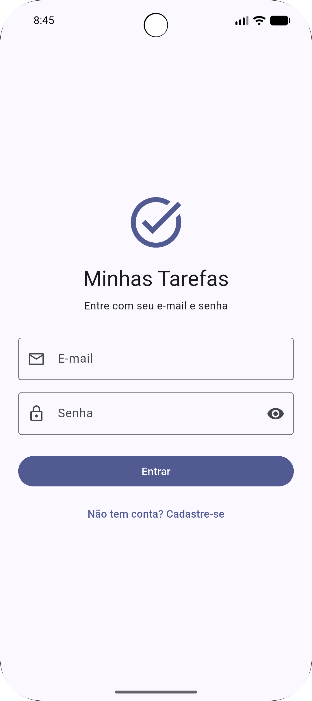
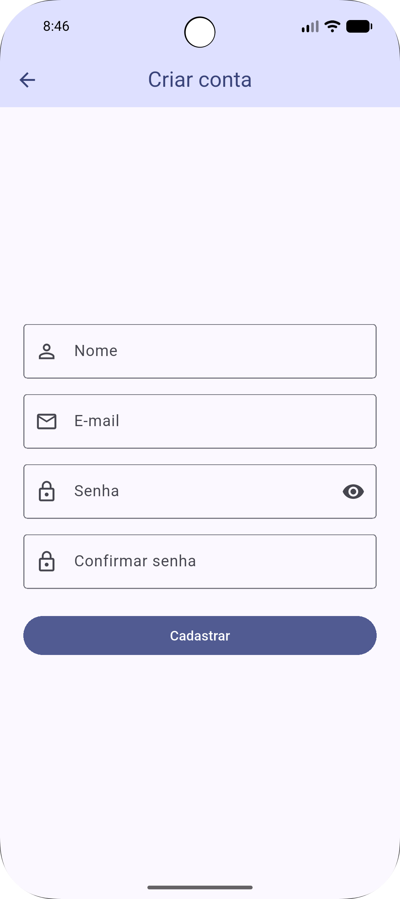
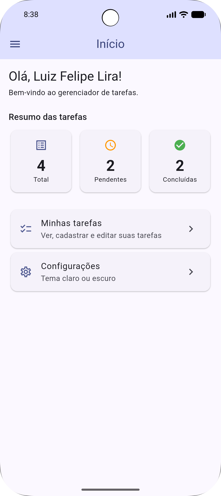
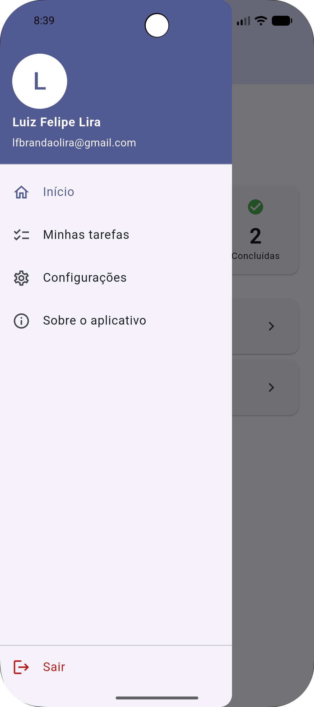
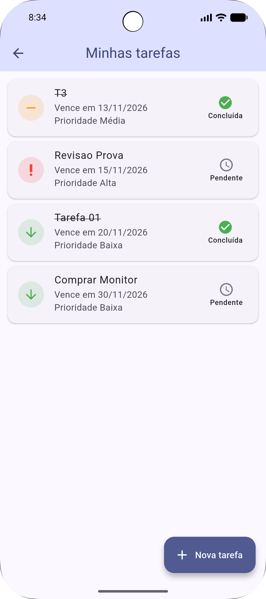
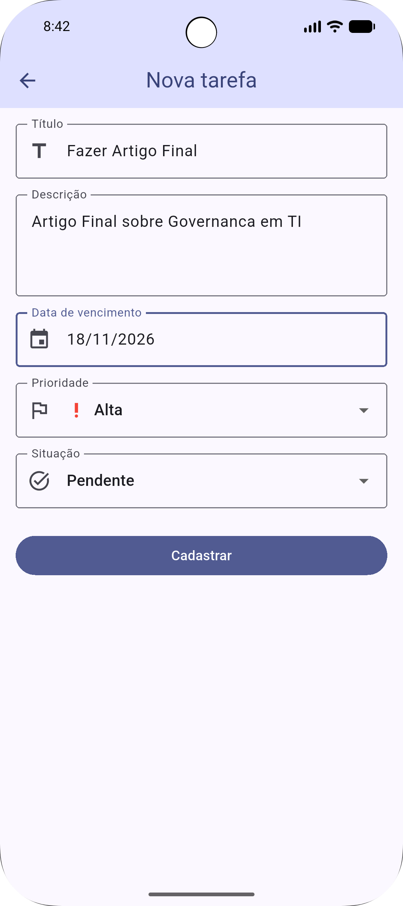
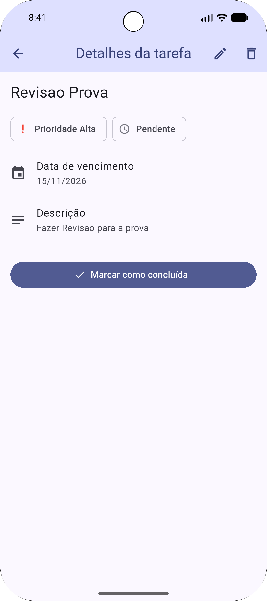
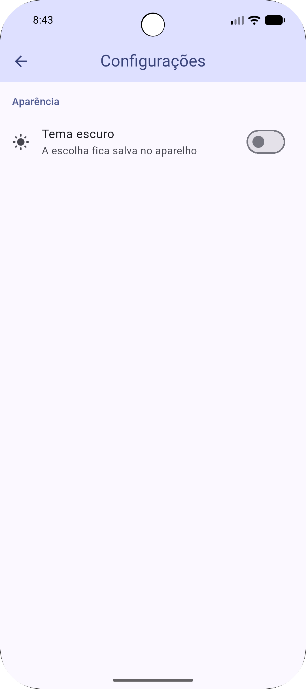
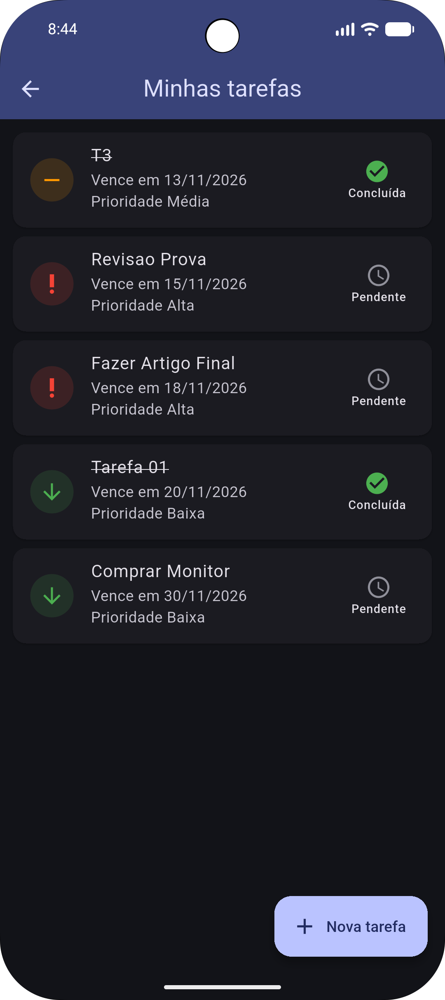
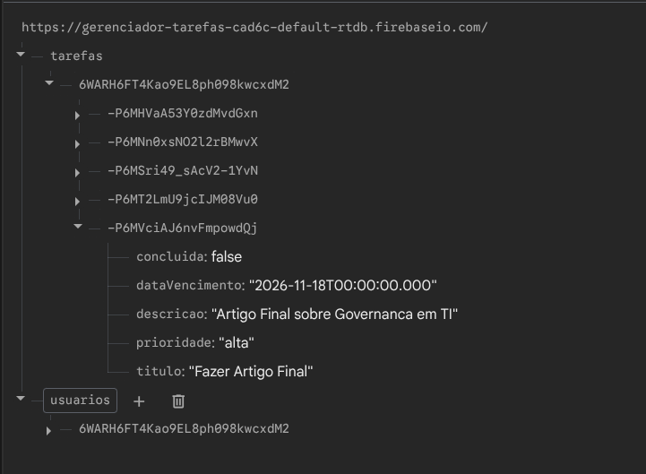

# Minhas Tarefas

Aplicativo de gerenciamento de tarefas pessoais desenvolvido em Flutter com Firebase, como atividade prática da P2 da disciplina de Programação Mobile.

**Aluno:** Luiz Felipe Brandão de Lira - RGM: 802.642
## Funcionalidades

- Cadastro de usuário com nome, e-mail e senha
- Login e logout com Firebase Authentication
- Sessão mantida ao fechar e reabrir o aplicativo
- Tela inicial com o nome do usuário e a quantidade de tarefas (total, pendentes e concluídas)
- Menu lateral (Drawer) com nome e e-mail do usuário logado
- Cadastro, consulta, edição e exclusão de tarefas
- Alternar a situação da tarefa entre pendente e concluída
- Listagem das tarefas em ListView, com cor e ícone indicando a prioridade
- Tarefas salvas no Firebase Realtime Database e atualizadas em tempo real
- Cada usuário só vê e altera as próprias tarefas
- Tema claro e escuro, com a escolha salva no aparelho (SharedPreferences)

## Tecnologias

| Tecnologia | Uso |
|---|---|
| Flutter 3.47 / Dart 3.13 | Desenvolvimento do aplicativo |
| firebase_core | Inicialização do Firebase |
| firebase_auth | Cadastro, login e sessão do usuário |
| firebase_database | Persistência das tarefas (Realtime Database) |
| shared_preferences | Preferência de tema |

## Estrutura do projeto

```
lib/
├── main.dart                         # Inicializa o Firebase e o tema
├── firebase_options.dart             # Configuração gerada pelo FlutterFire
├── models/
│   ├── usuario.dart                  # Model Usuario (uid, nome, email)
│   ├── tarefa.dart                   # Model Tarefa (id, titulo, descricao, dataVencimento, prioridade, concluida)
│   └── prioridade.dart               # Enum de prioridade com cor e ícone
├── screens/
│   ├── login_screen.dart
│   ├── cadastro_usuario_screen.dart
│   ├── home_screen.dart              # Tela inicial com os contadores
│   ├── tarefas_screen.dart           # Lista de tarefas (ListView)
│   ├── cadastro_tarefa_screen.dart   # Cadastro e edição de tarefa
│   ├── detalhe_tarefa_screen.dart    # Detalhes, exclusão e troca de situação
│   └── configuracoes_screen.dart     # Troca de tema
├── services/
│   ├── auth_service.dart             # Firebase Authentication
│   ├── firebase_service.dart         # CRUD no Realtime Database
│   └── preferences_service.dart      # SharedPreferences
├── themes/
│   ├── app_theme.dart                # lightTheme e darkTheme
│   └── theme_controller.dart         # Controle do ThemeMode
├── utils/
│   └── validadores.dart              # Validação dos formulários
└── widgets/
    ├── auth_gate.dart                # Decide entre login e tela inicial
    └── drawer_menu.dart              # Menu lateral
```

## Estrutura dos dados no Realtime Database

As tarefas ficam dentro do nó do usuário, identificado pelo `uid` do Firebase Authentication:

```
usuarios/
└── {uid}/
    ├── nome
    └── email
tarefas/
└── {uid}/
    └── {idTarefa}/
        ├── titulo
        ├── descricao
        ├── dataVencimento
        ├── prioridade      # baixa, media ou alta
        └── concluida       # true ou false
```

## Regras de segurança

Para garantir que cada usuário acesse apenas os próprios dados, o Realtime Database usa as regras abaixo:

```json
{
  "rules": {
    "usuarios": {
      "$uid": {
        ".read": "auth != null && auth.uid === $uid",
        ".write": "auth != null && auth.uid === $uid"
      }
    },
    "tarefas": {
      "$uid": {
        ".read": "auth != null && auth.uid === $uid",
        ".write": "auth != null && auth.uid === $uid"
      }
    }
  }
}
```

## Como executar

### Pré-requisitos

- Flutter SDK 3.47 ou superior
- Android Studio com um emulador, ou um celular Android com depuração USB ativada
- Git

### Usando o projeto Firebase já configurado

O repositório já contém os arquivos de configuração do Firebase (`lib/firebase_options.dart` e `android/app/google-services.json`), então basta:

```bash
git clone https://github.com/LuizBrand/p2-dev-mobile.git
cd p2-dev-mobile
flutter pub get
flutter run
```

### Usando outro projeto Firebase

1. Crie um projeto no [Console do Firebase](https://console.firebase.google.com/).
2. Em **Authentication → Método de login**, ative **E-mail/senha**.
3. Em **Realtime Database**, crie o banco e cole as regras da seção [Regras de segurança](#regras-de-segurança) na aba **Regras**.
4. Instale as ferramentas de linha de comando e faça login:
   ```bash
   npm install -g firebase-tools
   dart pub global activate flutterfire_cli
   firebase login
   ```
5. Na raiz do projeto, rode o comando abaixo e selecione o projeto criado. Ele gera novamente o `firebase_options.dart` e o `google-services.json`:
   ```bash
   flutterfire configure
   ```
6. Execute o app:
   ```bash
   flutter pub get
   flutter run
   ```

## Prints das telas

| Login | Cadastro | Tela inicial |
|---|---|---|
|  |  |  |

| Menu lateral | Lista de tarefas | Nova tarefa |
|---|---|---|
|  |  |  |

| Detalhes da tarefa | Configurações | Tema escuro |
|---|---|---|
|  |  |  |

**Dados no Firebase Realtime Database:**



## Vídeo de demonstração

https://drive.google.com/file/d/1WXIYlizaV19ruZGeBFGj3i09nI9pMAJC/view?usp=sharing